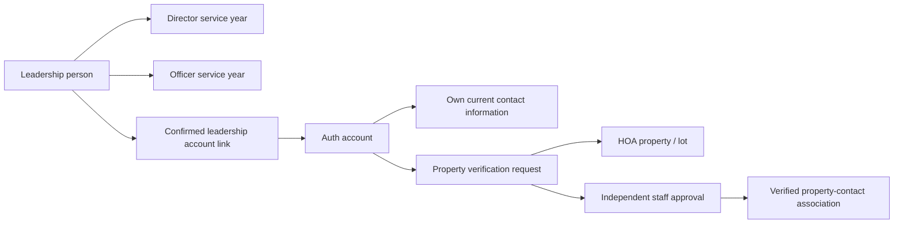

# Plum Creek portal setup and table reference

Implemented October 11, 2026 against the existing `plum-creek-hoa` Supabase project (`vjkdffiwgpoyrhbivfsa`). The handoff supplies project background; the user's current requests authorize these leadership, registration, member information and administration changes. The original SQL/CSV review remains in `supabase-development-review.md`.

## Pages

| Page | Behavior |
| --- | --- |
| `/board/` | Current public Director roster. Reads the latest published service year from Supabase, with current-only saved source as fallback. |
| `/officers/` | Current public President, Vice President, Secretary and Treasurer appointments. |
| `/portal/` | Signup, email confirmation return, login, password recovery, MFA and member navigation. |
| `/portal/reset-password/` | Dedicated new-password form after recovery, with matching-password confirmation and a fresh-link request for expired or invalid callbacks. |
| `/members/` | Own current contact details, property requests, approved properties, rental PDF uploads and current tenant lease dates. |
| `/admin/` | Directors/Officers with MFA review ownership, search all 119 properties and update occupancy. System administrators with MFA additionally manage leadership people, annual appointments and account links. |
| `/leadership/` | Current Directors/Officers with MFA maintain service contacts, attach contracts, and publish or draft minutes and announcements. |
| `/member-documents/` | Confirmed signed-in accounts download bylaws, search Board/Officer history, and read published minutes/announcements and their PDFs. |

Private pages export a sign-in shell with `noindex`. Private information loads only through authenticated database operations. UI visibility is not authorization. Browser code uses a modern publishable key; it contains no service-role key.

## Table reference

| Table | Purpose / relationship |
| --- | --- |
| `public.leadership_people` | Public display identity, separate from historical household contacts and Auth accounts. |
| `public.board_member_years` | Person + service year + Director seat/term label; `director`, `historical` or `vacant`. |
| `public.officer_positions` | President, Vice President, Secretary, Treasurer reference titles. |
| `public.officer_member_years` | Person + Officer position + service year. Historical changes within a year are preserved. |
| `private.leadership_account_links` | Explicit, revocable person-to-confirmed-current-account link. Never matched to a historical email automatically. |
| `private.portal_bootstrap_admin` | One designated first administrator email/person; activation waits for confirmation. The email is configured privately in Supabase and is not committed. |
| `private.signup_passcode` | Registration code and version. An administrator with MFA can choose 8–64 letters/numbers/hyphens or generate a random 24-character code. Only authorized leadership with MFA can retrieve it. See [signup passcode](signup-passcode.md). |
| `private.signup_tickets` | Hashed, email-bound, 10-minute signup tickets, consumed during account creation. |
| `private.signup_attempts` | Ten code attempts per normalized email per 15-minute window. |
| `public.portal_account_details` | Member-entered current name, phone and mailing address. Users access only their own row; these fields do not prove ownership. |
| `private.property_access_requests` | Pending/approved/rejected/revoked requests tied to account/property, with reviewer evidence and verified property-contact association. |
| `private.leadership_audit` | Protected code-access, leadership, ownership and occupancy audit events. |



## Permissions and member history

Updated October 12, 2026: public roster APIs and anonymous table policies return only the latest published appointments (no historical Board rows). Historical names are no longer embedded in static HTML or serialized page data. The authenticated `get_member_leadership_history()` API requires a confirmed, non-anonymous account; MFA is not needed to read member resources. Direct table policies enforce the same historical privacy.

The bylaws PDF moved from `public/documents/` into private `hoa-member-governance/plum-creek-bylaws.pdf` Storage. Its 3,786,266 bytes were uploaded and a downloaded copy was hash-checked against the original. A local backup remains in ignored `private-data/governance/`. Only confirmed accounts can read that exact object; there are no client upload, replacement or delete policies for this bucket. Its 5 MB PDF limit accommodates this existing document without raising the 1 MB publication or 2 MB contract limits. The old public PDF path is removed from the website export. Previously downloaded or archived copies cannot be recalled.

Private pages have a compact blue/gray portal shell, smaller headings and controls, signed-in account status, active navigation, native collapsible sections and Collapse all / Expand all. Closing a section retains unsaved fields. Appointment management defaults to the current year, supports searching and editing existing seats, and provides public roster preview links. Display-name and published appointment edits update live public pages without a site rebuild. System administrator + MFA authorization remains required for appointment changes. Property reviews default to pending requests with status filtering; property management and login linking are collapsed initially.

Publishing a roster is independent of granting login privileges. Privileges require a separately linked confirmed account, enabled appointment and current service dates. People can be Director, Officer, both or neither. Appointment date checks use PostgreSQL `current_date` (database timezone); role endpoints are inclusive. Bootstrap approves only the designated person's current-year Director/Officer records, from confirmation day through December 31. A multi-year public seat label does not automatically extend next year's login privileges.

Directors/Officers with MFA can view the code, review property requests and manage occupancy. System administrator is a separate existing `user_roles` assignment enabling appointment management and code rotation after MFA. Editable metadata never grants privileges. Disabled/expired appointments and revoked links are checked from live records on every protected operation.

The 2026 roster shows Michael Bruna as Director and President, preserving the existing seat label. Laura McKinney remains a Director. No replacement Vice President was supplied, so that office is vacant. Historical rows retain their original titles, including duplicate positions within some years, and grant no privileges. Historical `Board.txt` entries do not establish verified Director appointments.

## First administrator and signup

1. Open `/portal/`, select **Create account**, use the designated current email and choose a password of at least 12 characters. Leave the passcode blank for this designated initial signup only.
2. Confirm the email, then sign in. Confirmation activates the privately configured administrator link and current-year Director/President assignments.
3. Set up or verify an authenticator through the MFA panel. Then view the signup passcode and open **Leadership administration**.
4. Other homeowners register with the passcode, confirm an individual current email, enter contact details on `/members/`, and request property verification.
5. Other leaders register normally. The administrator explicitly links their confirmed account to a leadership person and approves dated appointments.

The code permits registration only: no automatic ownership or voting eligibility. Direct Auth signup is also guarded by `hoa_enforce_signup_gate` on `auth.users`; bypassing the form cannot bypass that check. The optional `public.hoa_before_user_created` Auth hook shares the validation, but configuring it is not required for the installed trigger guard. Only `supabase_auth_admin` can call that hook interface.

Tickets are bound to email and code version. Rotation invalidates unused tickets and the old code. A spent ticket is removed from Auth metadata; the code is never stored there. The secret is explicitly retrieved into page memory and cleared on sign-out, never added to static HTML, files or URLs. Rotate a shared code to withdraw that knowledge. Existing accounts can still log in/recover passwords after rotation.

## Property review

Separate accounts can be approved for one property, and one account can have multiple properties. Duplicate active requests for one account/property fail. Staff must independently check current ownership and record an evidence source or rejection/revocation reason; they cannot review their own request. Row locks protect decisions and serialize concurrent approvals across properties for one account.

Approval creates a fresh current contact if needed and an explicitly verified property association. It never searches for/promotes a historical email or household match. All 119 original contacts and 136 historical emails remain unverified. Member access checks approval, account/contact association, relationship, verification and effective dates. Portal property-contact ending dates are exclusive, so revoking today removes access immediately, even after same-day approval.

Occupancy changes support unknown / owner occupied / rental / vacant. Property status, timestamp, history and audit commit together; repeated values do not fabricate history. Staff directory historical names remain labeled **Historical / unverified**. Claimed balances and private leases are not included.

Rental homes now require a completed agreement PDF and lease dates covering today to access property details and member resources. Both homeowner declarations and staff-recorded rental occupancy enforce this requirement. Contact and upload forms remain available while restricted. New agreements use the private `hoa-rental-agreements` bucket; original document records remain locked. See [rental member access](rental-member-access.md) for permissions, limits, retention and verification.

## Deployment and email

The existing GitHub integration deploys the `plum-creek-hoa` Cloudflare Worker when `main` changes. The local `pnpm build` command also produces a static export suitable for Pages. Live roster, member data and Auth use Supabase from the browser.

- Local `.env.local` already has the project URL and publishable key and is ignored by Git. `.env.example` lists required variables.
- The tracked `lib/supabase-public-config.json` contains only the public project URL and modern publishable key for GitHub/Cloudflare builds without a local environment file. Optional `NEXT_PUBLIC_SUPABASE_URL` and `NEXT_PUBLIC_SUPABASE_PUBLISHABLE_KEY` build variables override those defaults. Never add a service-role/secret key.
- Supabase Site URL and its exact allowed callback are now `https://plumcreekgardner.com/portal/`. The former localhost default and empty callback allowlist caused hosted confirmation links to return to localhost. Both settings were updated and verified October 11, 2026. All auth callbacks use `/portal/`; allow any additional development callback explicitly before using it.
- Keep confirmation enabled. Live Auth settings confirm email registration is enabled and automatic confirmation is disabled.
- Production SMTP now uses Resend with the verified sender domain and branded confirmation/recovery templates. A user-approved recovery test was reported delivered by Resend. Confirmation-template content was checked in the hosted dashboard; a separate new-signup delivery test has not been run. [SMTP setup](https://supabase.com/docs/guides/auth/auth-smtp), [redirect configuration](https://supabase.com/docs/guides/auth/redirect-urls).
- Keep the private schema outside exposed Data API schemas. CAPTCHA/global abuse controls are a production follow-up; the application email limiter is not an IP/global limiter.

The website changes were pushed to GitHub on October 11, 2026, and Cloudflare's Workers Builds check succeeded for commit `1224e97`. The user provided the production domain and the Supabase redirect configuration is now verified. A read-only check confirmed the designated administrator's email is already confirmed. No signup email or invitation was sent by the agent, and the agent did not create an Auth account. The administrator chooses their own password and confirms their mailbox. Resend SMTP and the branded templates are now configured, as documented in `../supabase/email-templates/README.md`.

On October 11, 2026, connected Resend account access was verified and the dedicated sender domain `auth.plumcreekgardner.com` was created. The exact Resend DKIM TXT, return-path MX/SPF TXT and CNAME records were added to the existing Cloudflare zone. Resend subsequently reported the domain and all four records **verified**. Sending is enabled, receiving is disabled, and click/open tracking are disabled. The existing root and `www` website records were preserved.

Supabase custom SMTP is enabled with host `smtp.resend.com`, port `465`, username `resend`, and sender **Plum Creek HOA <no-reply@auth.plumcreekgardner.com>**. The user created and saved the credential directly in the dashboards. The Resend key **Plum Creek Supabase Auth SMTP** was checked afterward: Sending access, restricted to `auth.plumcreekgardner.com`. Its token was not printed or committed. The saved minimum interval is five minutes per user, with a global limit of 30 auth emails per hour. Email confirmation and the production Site URL/allowed callback remain enabled and unchanged.

Both confirmation/recovery subjects and HTML bodies were applied through a reviewed CLI config update. The hosted source and previews confirm Plum Creek branding and intact `{{ .ConfirmationURL }}` placeholders. A single user-approved password-reset email was accepted by Supabase and reported **delivered** by Resend. Its sender, recovery content and verification link returning to `https://plumcreekgardner.com/portal/` were checked without following the reset link. No password was changed by the agent. Delivery status confirms recipient-mail-server acceptance; inbox placement and completing the recovery flow were not tested. No separate signup email was sent. Read-only live portal/security checks passed again after the update.

Password recovery now returns to `https://plumcreekgardner.com/portal/reset-password/`, also allowed in Supabase's redirect list. Signup still returns to `/portal/`. Older valid recovery callbacks to `/portal/` are forwarded with their fragment intact before the Auth client starts. The dedicated page waits for Auth initialization and the session rather than depending on the one-time `PASSWORD_RECOVERY` notification. It also supports refresh and existing signed-in users. Browser checks with intercepted Auth responses cover immediate/delayed initialization, legacy callbacks, refresh, password mismatch, update success, expired callbacks with an existing session, and missing sessions. These checks send no real email and change no account.

## Migration state and validation

Eleven migrations are installed. The first four were created with the CLI, then file version prefixes were reconciled to versions returned by the MCP migration tool, avoiding duplicate migration attempts later. Subsequent feature migrations were created and applied with the CLI after checking the pending-file dry run:

| Recorded version | Migration |
| --- | --- |
| `20261011090630` | `leadership_and_signup_gate` |
| `20261011090641` | `public_leadership_roster_seed` |
| `20261011091457` | `leadership_policy_refinement` |
| `20261011092105` | `member_information_and_property_review` |
| `20261011214844` | `leadership_contacts_and_member_documents` |
| `20261012172745` | `private_member_resources` |
| `20261012183531` | `rental_member_access` |
| `20261012185831` | `rental_review_index` |
| `20261012190718` | `member_details_events_and_service_vault` |
| `20261012193614` | `household_value_validation` |
| `20261012194703` | `explicit_occupancy_and_notification_email` |

These require the installed original HOA schema and companion contact-import setup. Do not reset production or rerun its original creation SQL. Reference SQL is unchanged. Public seed generation reads only `Info/Board.txt` and `Info/Leadership2026.json`, using source-key lookups rather than hardcoded production UUIDs.

Checks include build/TypeScript, ESLint, rendered HTML, actual migrations executed in isolated PGlite PostgreSQL with Supabase role/claim fixtures, live read-only HTTP roster/private-access and email-confirmation checks, and Supabase advisors. PGlite uses PostgreSQL 18; production uses PostgreSQL 17. A real confirmed-account/MFA browser test remains pending the first administrator's login.

The contacts/documents update introduced no new security advisor findings. The baseline has a leaked-password-protection warning (the free plan does not include that feature). [RLS-without-policy information notices](https://supabase.com/docs/guides/database/database-linter?lint=0008_rls_enabled_no_policy) are intentional for private/helper and locked original tables: access uses narrow authorized functions. Original contact/rental foreign-key index findings are recorded in the initial review. New feature foreign keys are indexed. Unused indexes are retained pending real usage.

See [member details, calendar and password safe guide](member-details-calendar-and-safe.md) for structured contact fields, joint ownership/trust records, email-change confirmation, notice consent, calendar publishing and restricted encrypted service credentials.

See [contacts and documents guide](leadership-contacts-and-documents.md) for access, upload limits, storage math and verification details.

```powershell
pnpm lint
pnpm test
./tests/review-handoff.test.ps1
./scripts/review-handoff.ps1 -ArchivePath 'C:/Users/micha/Downloads/plum_creek_codex_handoff.zip'
node scripts/check-supabase-interface.mjs
```

The live smoke script reads only and prints no keys, passcodes or private records.
